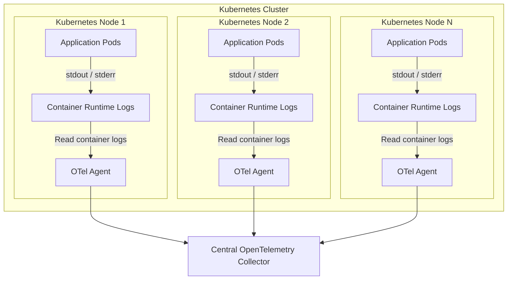

# OpenTelemetry Agent Architecture

## 1. Overview

OpenTelemetry (OTel) Agent is responsible for collecting application container logs from Kubernetes nodes and forwarding them to a centralized OpenTelemetry Collector.

The Agent is based on the OpenTelemetry Collector and runs as a Kubernetes DaemonSet, ensuring that an Agent instance is deployed on every eligible Kubernetes node.

The initial implementation focuses on collecting container logs generated through `stdout` and `stderr`.

## 2. Architecture



The central Collector is part of the planned architecture and will be implemented separately.

## 3. OTel Agent Responsibilities

Each OTel Agent performs the following operations:

- **Log collection:** Reads container logs from the node filesystem.
- **Log parsing:** Processes container log formats and extracts log records.
- **Metadata enrichment:** Associates logs with Kubernetes metadata.
- **Log forwarding:** Sends collected logs to the configured telemetry destination.

## 4. Log Collection

Applications running inside Kubernetes containers can generate logs through standard output and standard error.

The container runtime captures these streams and makes the logs available on the Kubernetes node.

The standard Kubernetes log directory is:

```text
/var/log/pods/
```

Example directory structure:

```text
/var/log/pods/
└── crouseserviceloan-develop_pod-name_pod-uid/
    └── crouseserviceloan/
        └── 0.log
```

The OTel Agent uses the OpenTelemetry Filelog Receiver to read these log files.

The Agent requires access to the node's container log directory, typically through a read-only hostPath volume mount.

## 5. Kubernetes Metadata

The Agent enriches collected logs with Kubernetes metadata to identify their origin.

Relevant metadata includes:

| Attribute | Description |
|---|---|
| `k8s.namespace.name` | Kubernetes namespace |
| `k8s.pod.name` | Pod name |
| `k8s.container.name` | Container name |
| `k8s.node.name` | Kubernetes node name |
| `k8s.pod.uid` | Unique Pod identifier |

The Kubernetes Attributes Processor is responsible for associating telemetry records with Kubernetes resources.

The Agent requires appropriate Kubernetes API access and RBAC permissions for metadata enrichment.

## 6. Deployment Architecture

The OTel Agent is deployed using the official OpenTelemetry Collector Helm chart.

Deployment configuration:

| Component | Configuration |
|---|---|
| Helm chart | `opentelemetry-collector` |
| Deployment mode | DaemonSet |
| Namespace | `monitoring` |
| Receiver | Filelog |
| Processor | Kubernetes Attributes |
| Log source | `/var/log/pods/` |
| Host access | Read-only volume mount |
| Management | Argo CD |
| Configuration management | GitOps |

A DaemonSet ensures that an Agent instance runs on each eligible Kubernetes node.

Node selectors and tolerations are configured as necessary to include control-plane and worker nodes.

## 7. Log Processing Flow

The collection process follows these steps:

1. An application generates a log through `stdout` or `stderr`.
2. The container runtime captures the output.
3. The runtime stores the container logs on the Kubernetes node.
4. The Filelog Receiver reads the log files.
5. The Kubernetes Attributes Processor enriches the log records with Kubernetes metadata.
6. The Agent forwards the processed logs to the configured destination.

## 8. Storage and Retention

The OTel Agent does not provide long-term log storage.

Container logs are stored locally on Kubernetes nodes and are subject to container runtime log rotation and cleanup.

The Agent is responsible for collecting and forwarding logs before they become unavailable locally.

Centralized storage and retention will be handled by the planned Elasticsearch integration.

## 9. Scope and Future Extensions

The initial implementation includes:

- Kubernetes container log collection.
- Structured application console logs.
- Kubernetes metadata enrichment.
- Centralized log forwarding.

The following components will be documented and implemented separately:

- Central OpenTelemetry Collector Gateway.
- Elasticsearch integration and log indexing.
- Kibana log search and visualization.
- Log retention and lifecycle management.
- Additional telemetry collection, including traces.

## 10. References

- [OpenTelemetry Collector](https://opentelemetry.io/docs/collector/)
- [OpenTelemetry Kubernetes Deployment](https://opentelemetry.io/docs/platforms/kubernetes/helm/collector/)
- [OpenTelemetry Filelog Receiver](https://github.com/open-telemetry/opentelemetry-collector-contrib/tree/main/receiver/filelogreceiver)
- [Kubernetes Attributes Processor](https://github.com/open-telemetry/opentelemetry-collector-contrib/tree/main/processor/k8sattributesprocessor)